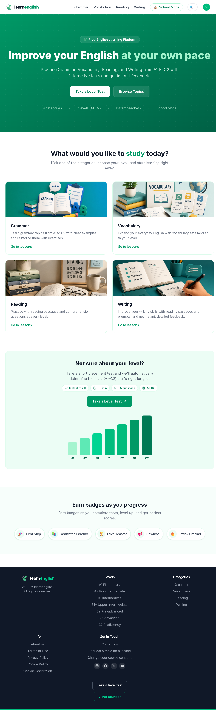
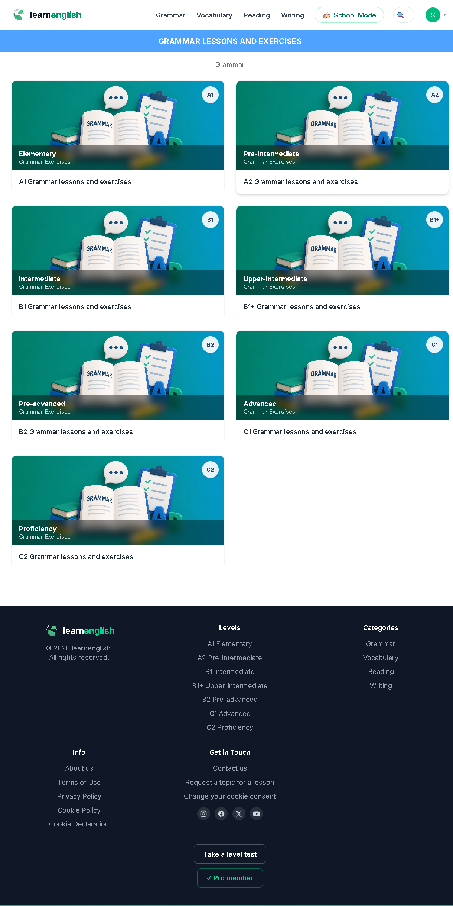
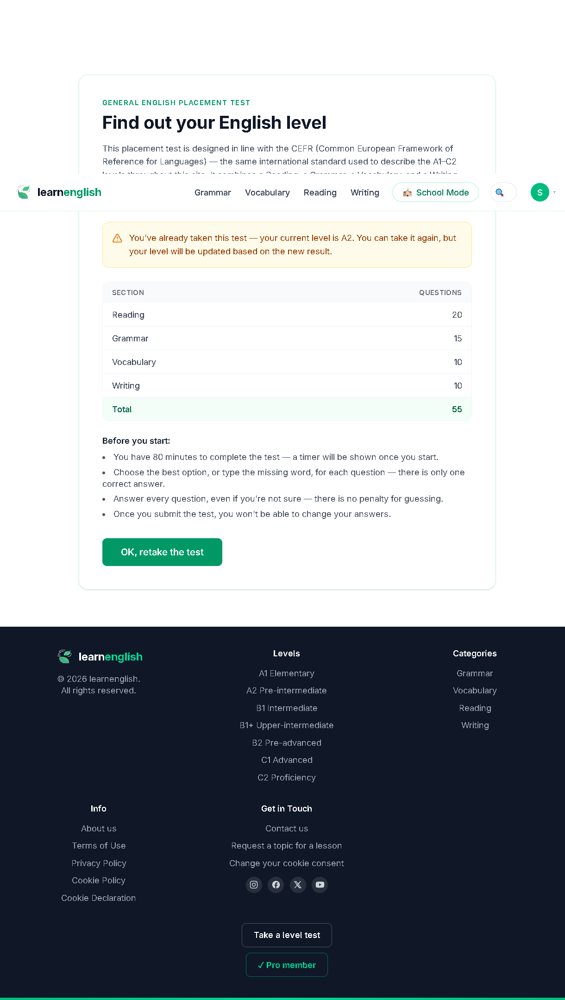
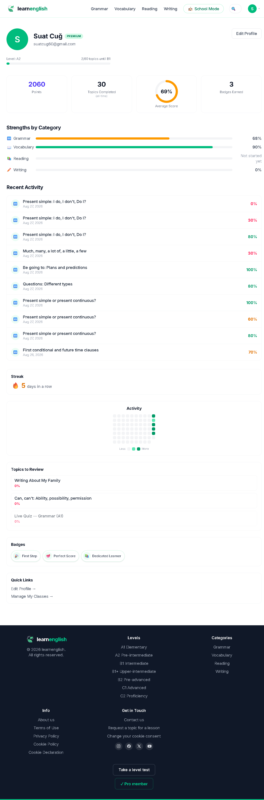
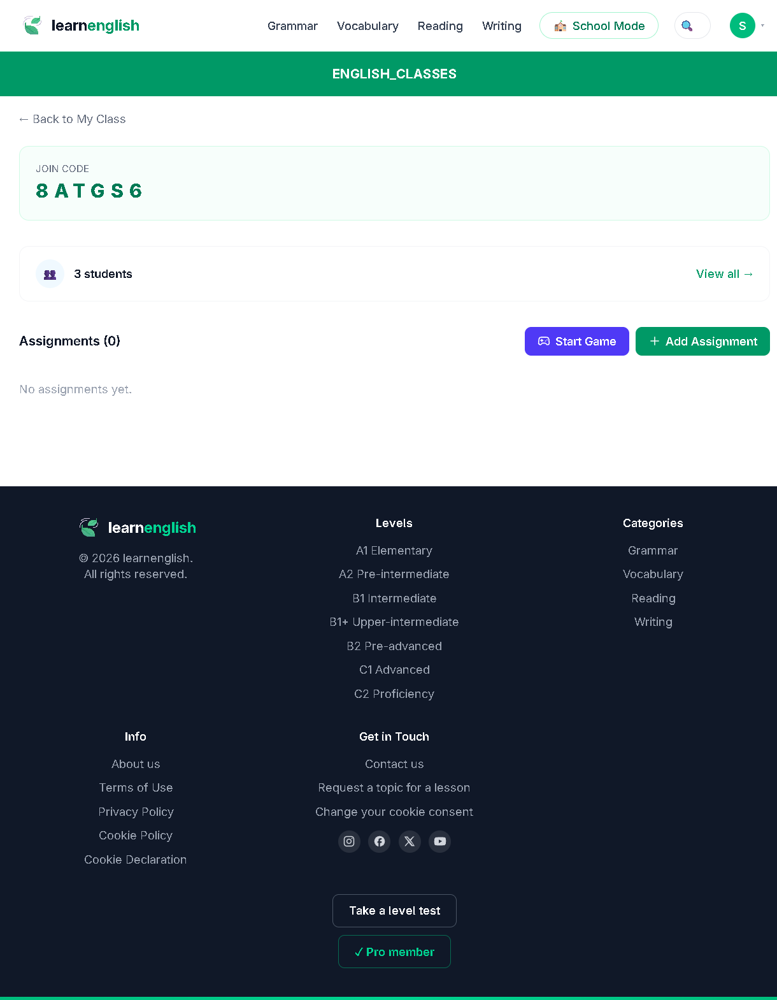
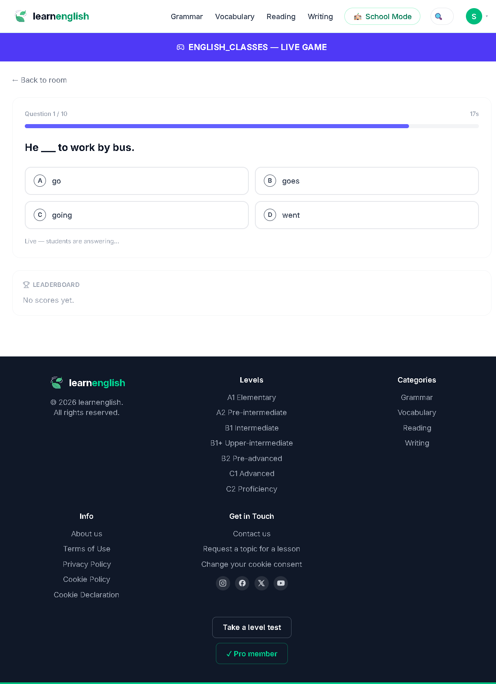
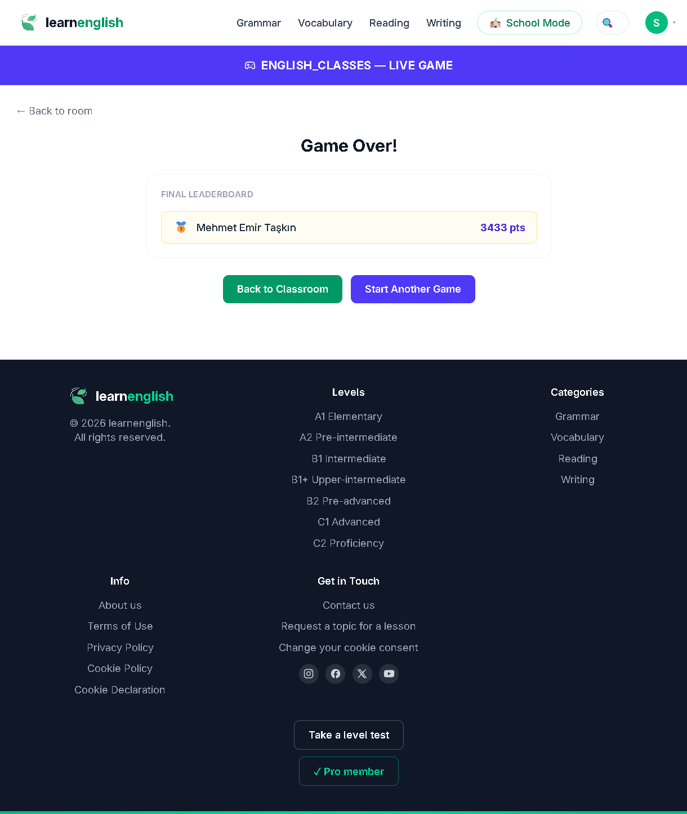

<div align="center">

# learnenglish 🍃

**A1'den C2'ye kadar dilbilgisi, kelime, okuma ve yazma pratiği yapılan;
interaktif testler, anlık geri bildirim, seviye tespit sınavı ve öğretmenlerin
canlı quiz oynatabildiği "Okul Modu" ile birlikte gelen bir İngilizce öğrenme
platformu.**

[Özellikler](#-özellikler) · [Ekran görüntüleri](#-ekran-görüntüleri) · [Teknolojiler](#-kullanılan-teknolojiler) · [Kurulum](#-yerelde-çalıştırma) · [Deploy](#️-deploy)


🔗 **Canlı demo:** <!-- Netlify site adresini buraya ekle: https://<site-adı>.netlify.app -->

</div>

---

## Proje hakkında

learnenglish, İngilizce öğrenenlerin kendi hızında ilerleyebildiği bir alıştırma
platformudur. İçerik dört kategoriye ve yedi CEFR seviyesine (A1, A2, B1, B1+, B2,
C1, C2) ayrılır:

- **🔤 Grammar** – Her seviyede konu anlatımı + üç bölümlü alıştırma seti
  (çoktan seçmeli, boşluk doldurma, eşleştirme/dönüştürme). Konu başlıkları
  test-english.com müfredatıyla birebir eşleşecek şekilde hazırlanmıştır.
- **📖 Vocabulary** – Seviyeye göre kelime setleri, konu anlatımı ve üç bölümlü
  alıştırma.
- **📚 Reading** – Okuma parçası + 5 çoktan seçmeli kavrama sorusundan oluşan
  tek bölümlü alıştırma.
- **✏️ Writing** – Kelime kutusu ve tek bir metin içine yerleştirilmiş 10 satır
  içi boşluktan oluşan tek bölümlü alıştırma.

Kullanıcı bir alıştırmayı tamamlayınca cevaplar sunucuda kontrol edilir, anlık
puan ve açıklamalı geri bildirim döner; sonuç kalıcı ilerlemeye (streak, seviye
çubuğu, kategori dağılımı) ve gerektiğinde rozetlere işlenir.

> **Not:** Bu depo, çalışması için gerçek bir backend'e ihtiyaç duyar. Sahte/mock
> API katmanı yoktur; frontend, `VITE_API_URL` üzerinden Express + MongoDB API'sine
> bağlanır. Kurulum için [Yerelde çalıştırma](#-yerelde-çalıştırma) bölümüne bakın.

## ✨ Özellikler

**Öğrenme deneyimi**
- Kategori → seviye → konu akışıyla ders keşfi ve Navbar üzerinden anlık konu araması
- Dilbilgisi/kelime derslerinde 3 bölümlü, okuma/yazma derslerinde 1 bölümlü alıştırma yapısı
- Cevapların sunucuda kontrolü, soru bazında açıklama ve "cevap anahtarını gör" / "tekrar dene" seçenekleri
- Konu tamamlanınca ilerlemenin `User.progress` içine kaydedilmesi

**Seviye tespit sınavı**
- ~55 soru, ~80 dakika, A1–C2 aralığında bölümlere (reading/grammar/vocabulary/writing) ayrılmış test
- Sınav sonunda kullanıcının seviyesinin otomatik atanması (`placementTestCompleted`)

**İlerleme & rozetler**
- Profil sayfasında güncel streak, seviye ilerleme çubuğu ve kategori kırılımı
- Kriter tabanlı rozet motoru: `topics_completed`, `level_completed`, `perfect_score`, `streak`
  (örn. *First Step*, *Dedicated Learner*, *Level Master*, *Perfect Score*, *On a Roll*)
- Profilden bilgi güncelleme, şifre değiştirme ve hesap silme

**🏫 Okul Modu (Premium)**
- Öğretmenlerin 6 haneli katılım koduyla sınıf oluşturması, öğrencilerin kodla katılması
- Rol bazlı yetki: sınıf sahibi öğretmen ↔ öğrenci
- **Canlı quiz (Kahoot tarzı):** Socket.io ile oda oluşturma, süreli sorular, her sorudan sonra
  cevabın açıklanması (reveal), canlı skor tablosu ve oyun sonu sonuçlarının kalıcı ilerlemeye yazılması
- Sınıf bazında sonuç/performans görünümü

**Altyapı**
- JWT tabanlı kimlik doğrulama, rol bazlı yetkilendirme (`user` / `admin`) ve `isPremium` bayrağı
- `express-validator` ile istek doğrulama, `helmet` + `cors` + `morgan` katmanları
- Socket.io için token doğrulamalı el sıkışma; oda bazlı (roomCode) canlı iletişim
- Admin için konu ve soru CRUD uçları
- `npm run seed` ile örnek konu, soru ve rozet verisinin yüklenmesi

## 📸 Ekran görüntüleri

> Görselleri `docs/screenshots/` klasörüne ekleyip aşağıdaki tabloyu güncelleyin.
> (Klasör henüz depoda yok; ilk görselleri eklerken siz oluşturacaksınız.)

| | |
|---|---|
| **Ana sayfa** <br>  | **Kategori / seviye seçimi** <br>  |
| **Ders — alıştırma ve geri bildirim** <br>  | **Seviye tespit sınavı** <br>  |
| **Profil — streak & ilerleme** <br>  | **Okul Modu — sınıf** <br>  |
| **Canlı quiz — soru** <br>  | **Canlı quiz — skor tablosu** <br>  |

## 🛠 Kullanılan teknolojiler

| | |
|---|---|
| **Frontend** | React 19, Vite 8, Redux Toolkit + RTK Query, React Router 7, Tailwind CSS 4, Axios, Socket.io Client, lucide-react, oxlint |
| **Backend** | Node.js, Express 5, MongoDB + Mongoose, JWT (jsonwebtoken), bcryptjs, Socket.io, express-validator, helmet, morgan, cors, dotenv |
| **Deploy** | Netlify (frontend) · herhangi bir Node barındırıcı + MongoDB Atlas (backend) |

## 📁 Proje yapısı

```
learn_english/
├── backend/                 # Express 5 API + Socket.io
│   ├── config/              # MongoDB bağlantısı (db.js)
│   ├── controllers/         # auth, topic, question, user, placementTest, badge, classroom
│   ├── middlewares/         # auth, role, requirePremium, classroomTeacher, validate, error
│   ├── models/              # User, Topic, Question, Badge, Classroom, Assignment (Mongoose)
│   ├── routes/              # /api/* uç tanımları
│   ├── services/            # gameSession.service.js (canlı quiz durum yönetimi)
│   ├── sockets/             # Socket.io oyun olayları (create/join/start/answer/reveal/over)
│   ├── validations/         # express-validator kural setleri
│   ├── utils/               # seed.js, badgeEngine, checkAnswer, jwt, progress yardımcıları
│   └── index.js             # sunucu girişi (HTTP + Socket.io)
└── frontend/                # React (Vite) istemcisi
    ├── public/              # favicon, _redirects (Netlify SPA yönlendirmesi)
    └── src/
        ├── app/             # Redux store + authSlice
        ├── components/      # auth/ home/ layout/ lesson/ + ScrollToTop
        ├── pages/           # Home, Login, Register, CategoryLevels, TopicList,
        │                    # Lesson, PlacementTest, Profile, Classroom*, LiveGame ...
        ├── services/        # RTK Query API dilimleri (auth, topics, users, placement, classroom)
        └── lib/             # constants, socket, grammar/vocabulary/writing açıklamaları
```

## 🚀 Yerelde çalıştırma

Gerekli: **Node.js 18+** ve bir **MongoDB** veritabanı
([MongoDB Atlas](https://www.mongodb.com/atlas) ücretsiz planı ya da yerel `mongod`).

```bash
# 1) Backend
cd backend
npm install
cp .env.example .env        # değerleri kendi bilgilerinle doldur (aşağıya bak)
npm run seed                # örnek konu/soru/rozet verisini yükle (bir kez)
npm run dev                 # http://localhost:5000

# 2) Frontend (yeni terminal)
cd frontend
npm install
cp .env.example .env        # VITE_API_URL=http://localhost:5000/api
npm run dev                 # http://localhost:5173
```

### Ortam değişkenleri

**`backend/.env`**

| Değişken | Açıklama |
|---|---|
| `PORT` | API portu (varsayılan `5000`) |
| `NODE_ENV` | `development` / `production` |
| `MONGO_URI` | MongoDB bağlantı dizesi |
| `JWT_SECRET` | JWT imzalama anahtarı (zorunlu) |
| `JWT_EXPIRES_IN` | Token ömrü (örn. `7d`) |
| `CLIENT_URL` | İzin verilen frontend origin(leri); birden fazlaysa virgülle ayır |

**`frontend/.env`**

| Değişken | Açıklama |
|---|---|
| `VITE_API_URL` | Backend API kök adresi (örn. `http://localhost:5000/api`). Socket.io adresi bundan türetilir. |

### Faydalı komutlar

| Konum | Komut | İş |
|---|---|---|
| backend | `npm run dev` | Nodemon ile API |
| backend | `npm start` | Prod modda API |
| backend | `npm run seed` | Veritabanına örnek içerik yükle |
| frontend | `npm run dev` | Vite geliştirme sunucusu |
| frontend | `npm run build` | Üretim derlemesi (`dist/`) |
| frontend | `npm run preview` | Derlemeyi yerelde önizle |
| frontend | `npm run lint` | oxlint |

## 🌐 API uçları (özet)

Tüm uçlar `/api` önekiyle sunulur. `🔒` kimlik doğrulama, `🔒 admin` yalnız admin
rolü, `⭐ premium` yalnız premium kullanıcı gerektirir.

| Yöntem | Uç | Açıklama |
|---|---|---|
| `POST` | `/auth/register` · `/auth/login` | Kayıt / giriş |
| `GET` | `/topics` | Konu listesi (kategori, seviye, `search` filtreleri) |
| `GET` | `/topics/:id` · `/topics/:id/questions` | Konu detayı / soruları |
| `POST` | `/topics/:id/check` 🔒 | Alıştırma cevaplarını kontrol et, puan + açıklama döndür |
| `POST/PUT/DELETE` | `/topics` · `/questions` 🔒 admin | Konu / soru CRUD |
| `GET` | `/placement-test` | Seviye tespit sorularını getir |
| `POST` | `/placement-test/submit` 🔒 | Sınavı gönder, seviye ata |
| `GET` | `/badges` | Rozet kataloğu |
| `GET/PATCH/DELETE` | `/users/me` 🔒 | Profil bilgisi / güncelleme / hesap silme |
| `PATCH` | `/users/me/password` 🔒 | Şifre değiştirme |
| `POST` | `/users/progress` 🔒 | İlerleme kaydı ekleme |
| `GET/POST` | `/classrooms` 🔒 (`POST` ⭐ premium) | Sınıflarım / sınıf oluşturma |
| `POST` | `/classrooms/join` 🔒 | Katılım koduyla sınıfa katılma |
| `GET` | `/classrooms/:id` · `/classrooms/:id/results` 🔒 | Sınıf detayı / sonuçları |

**Socket.io olayları (canlı quiz):** `game:create`, `game:join`, `game:start`,
`game:answer` ↔ `game:question`, `game:reveal`, `game:leaderboard`, `game:activity`,
`game:playersUpdate`, `game:over`.

## ☁️ Deploy

**Frontend → Netlify**
- Site oluştururken *Base directory* = `frontend`, *Build command* = `npm run build`, *Publish directory* = `frontend/dist`.
- SPA yönlendirmesi `frontend/public/_redirects` dosyasındaki `/* /index.html 200` kuralıyla sağlanır
  (doğrudan `/login` gibi bir path'e gidince 404 olmaması için).
- Ortam değişkeni: `VITE_API_URL` = yayınlanan backend'in `/api` adresi.
- `main` branch'e her push'ta Netlify otomatik yeniden build alır.

**Backend → Node barındırıcı (Render, Railway, Fly.io vb.)**
- `backend/` klasörü deploy edilir; başlatma komutu `npm start`.
- Ortam değişkenleri: `MONGO_URI` (MongoDB Atlas), `JWT_SECRET`, `JWT_EXPIRES_IN`,
  `CLIENT_URL` (Netlify site adresi), `NODE_ENV=production`.
- Veritabanı boşsa bir kez `npm run seed` çalıştırılmalı.

## 📄 Lisans

MIT — kök dizine bir `LICENSE` dosyası ekleyerek resmileştirebilirsiniz.
